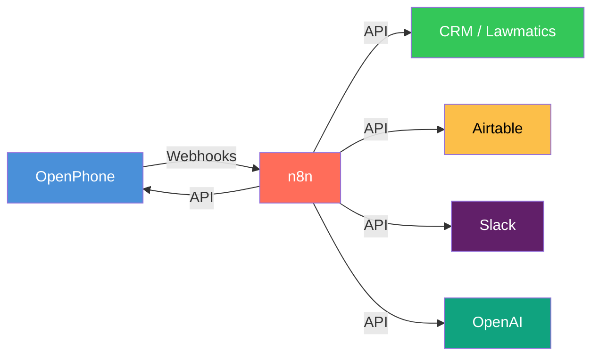
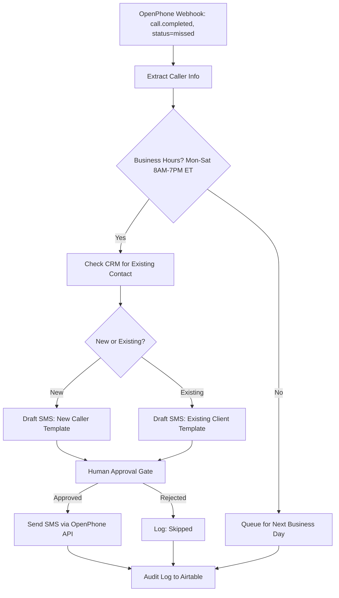
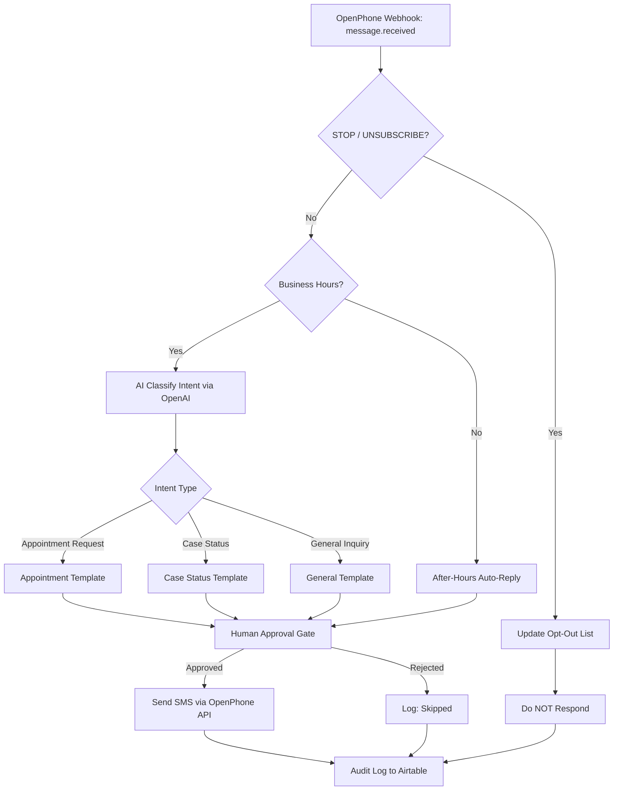
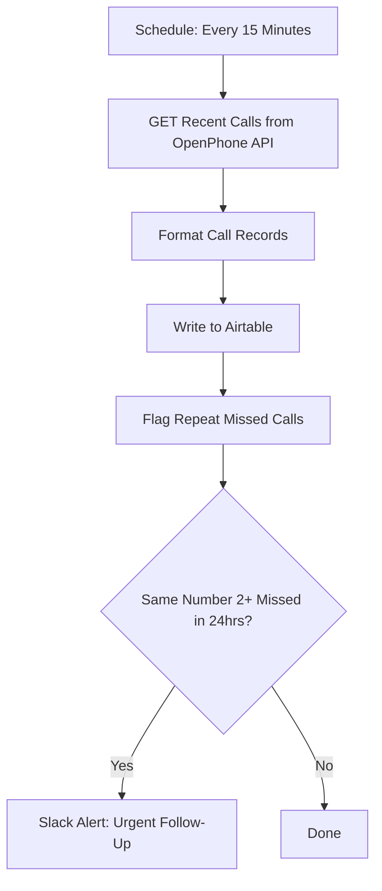
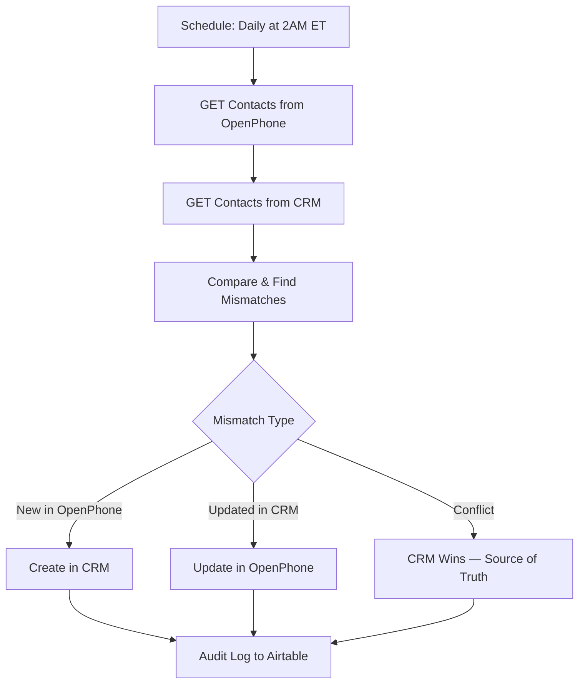

# OpenPhone + n8n Connector

A collection of production-ready n8n workflows for integrating [OpenPhone](https://www.openphone.com/) with CRM, Airtable, Slack, and AI services. Built for law firms and professional services teams that need reliable phone automation with TCPA compliance baked in.

## Architecture Overview



## Workflows

### 1. Missed Call Recovery

Automatically detects missed calls, checks business hours, identifies if the caller is a known contact, and sends a recovery SMS — with human approval before any message goes out.



**File:** [`workflows/missed-call-recovery.json`](workflows/missed-call-recovery.json)

---

### 2. SMS Auto-Responder

Handles inbound SMS with TCPA-compliant opt-out detection, AI-powered intent classification, and templated responses routed by intent.



**File:** [`workflows/sms-auto-responder.json`](workflows/sms-auto-responder.json)

---

### 3. Call Log Sync

Polls OpenPhone every 15 minutes, formats call records, writes them to Airtable, and alerts Slack when the same number has 2+ missed calls within 24 hours.



**File:** [`workflows/call-log-sync.json`](workflows/call-log-sync.json)

---

### 4. Contact Sync

Daily bidirectional sync between OpenPhone and CRM. CRM is the source of truth for conflict resolution.



**File:** [`workflows/contact-sync.json`](workflows/contact-sync.json)

---

## TCPA Compliance

All SMS workflows include mandatory TCPA safeguards:

- **STOP/UNSUBSCRIBE handling** — Immediate opt-out, no further messages sent
- **Business hours only** — Mon-Sat 8AM-7PM ET (no Sundays)
- **Human approval gates** — No automated outbound SMS without review
- **Consent tracking** — Logged in Airtable audit trail
- **Penalties** — Up to $1,500 per non-compliant message

See [`docs/tcpa-compliance.md`](docs/tcpa-compliance.md) for the full guide.

---

## Quick Start

1. **Import workflows** — In n8n, go to Workflows > Import and select any `.json` file from `workflows/`
2. **Configure credentials** — Set up OpenPhone API key, CRM API credentials, Airtable token, Slack webhook, and OpenAI key in n8n Credentials
3. **Update placeholders** — Replace placeholder URLs and IDs in HTTP Request nodes with your actual endpoints
4. **Set up OpenPhone webhooks** — Point webhooks to your n8n webhook URLs (see [`docs/openphone-webhooks.md`](docs/openphone-webhooks.md))
5. **Test with sample payloads** — Use files in `payloads/` to test each workflow
6. **Activate** — All workflows ship as `active: false` — enable when ready

## Project Structure

```
openphone-n8n-connector/
├── workflows/
│   ├── missed-call-recovery.json
│   ├── sms-auto-responder.json
│   ├── call-log-sync.json
│   └── contact-sync.json
├── payloads/
│   ├── missed-call-event.json
│   ├── incoming-sms-event.json
│   ├── call-log-response.json
│   └── contact-sync-result.json
├── docs/
│   ├── tcpa-compliance.md
│   └── openphone-webhooks.md
├── .gitignore
├── LICENSE
├── CONTRIBUTING.md
├── CHANGELOG.md
└── README.md
```

## License

MIT License. See [LICENSE](LICENSE).
