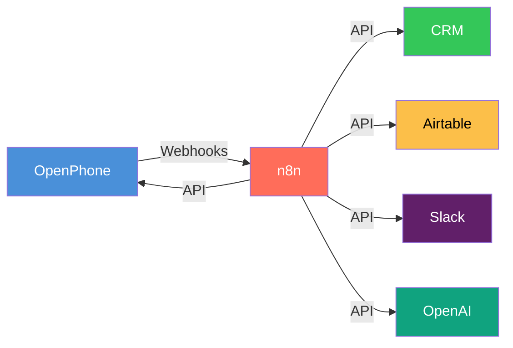
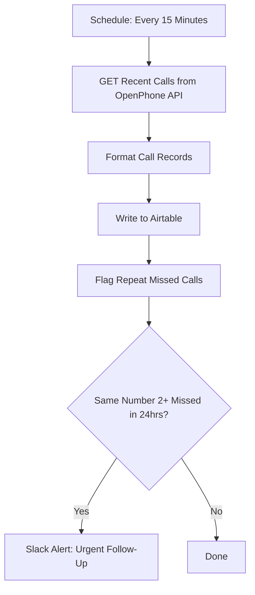
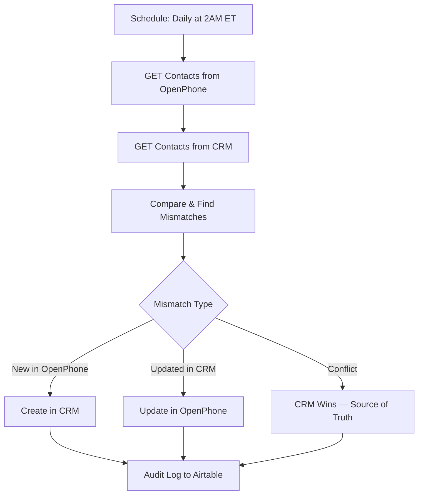

# openphone-n8n-connector

Example n8n workflows for [OpenPhone](https://www.openphone.com/) events and connected systems. They are examples and have not been independently reviewed for deployment or legal compliance; review consent and approval handling before any outbound message.

## Architecture Overview



## Workflows

### 1. Missed Call Recovery

The example sketches missed-call handling and a proposed SMS. A real blocking approval and consent check must be verified separately before any send.

```mermaid
flowchart TD
    A[OpenPhone Webhook: call.completed, status=missed] --> B[Extract Caller Info]
    B --> C{Business Hours? Mon-Sat 8AM-7PM ET}
    C -->|Yes| D[Check CRM for Existing Contact]
    C -->|No| E[Queue for Next Business Day]
    D --> F{New or Existing?}
    F -->|New| G[Draft SMS: New Caller Template]
    F -->|Existing| H[Draft SMS: Existing Client Template]
    G --> I[Approval point (implementation to verify)]
    H --> I
    I -->|Approved| J[Send SMS via OpenPhone API]
    I -->|Rejected| K[Log: Skipped]
    J --> L[Audit Log to Airtable]
    K --> L
    E --> L
```

**File:** [`workflows/missed-call-recovery.json`](workflows/missed-call-recovery.json)

---

### 2. SMS Auto-Responder

The example sketches an opt-out branch, classification and draft responses. That flow alone does not establish consent or regulatory compliance.

```mermaid
flowchart TD
    A[OpenPhone Webhook: message.received] --> B{STOP / UNSUBSCRIBE?}
    B -->|Yes| C[Update Opt-Out List]
    C --> D[Do NOT Respond]
    B -->|No| E{Business Hours?}
    E -->|No| F[After-Hours Auto-Reply]
    E -->|Yes| G[AI Classify Intent via OpenAI]
    G --> H{Intent Type}
    H -->|Appointment Request| I[Appointment Template]
    H -->|Case Status| J[Case Status Template]
    H -->|General Inquiry| K[General Template]
    I --> L[Approval point (implementation to verify)]
    J --> L
    K --> L
    F --> L
    L -->|Approved| M[Send SMS via OpenPhone API]
    L -->|Rejected| N[Log: Skipped]
    M --> O[Audit Log to Airtable]
    N --> O
    D --> O
```

**File:** [`workflows/sms-auto-responder.json`](workflows/sms-auto-responder.json)

---

### 3. Call Log Sync

Polls OpenPhone every 15 minutes, formats call records, writes them to Airtable, and alerts Slack when the same number has 2+ missed calls within 24 hours.



**File:** [`workflows/call-log-sync.json`](workflows/call-log-sync.json)

---

### 4. Contact Sync

Daily bidirectional sync between OpenPhone and CRM. CRM is the source of truth for conflict resolution.



**File:** [`workflows/contact-sync.json`](workflows/contact-sync.json)

---

## Messaging safety and legal review

These workflow diagrams are examples, not a compliance determination. Opt-out handling, hours, logging and an illustrated approval point do not by themselves establish consent or a working blocking review step. The separate `docs/tcpa-compliance.md` page is also unreviewed and must not be treated as current legal guidance without a dedicated review.

---

## Quick Start

1. **Import workflows** — In n8n, go to Workflows > Import and select any `.json` file from `workflows/`
2. **Configure credentials** — Set up OpenPhone API key, CRM API credentials, Airtable token, Slack webhook, and OpenAI key in n8n Credentials
3. **Update placeholders** — Replace placeholder URLs and IDs in HTTP Request nodes with your actual endpoints
4. **Set up OpenPhone webhooks** — Point webhooks to your n8n webhook URLs (see [`docs/openphone-webhooks.md`](docs/openphone-webhooks.md))
5. **Test with sample payloads** — Use files in `payloads/` to test each workflow
6. **Activate** — All workflows ship as `active: false` — enable when ready

## Project Structure

```
openphone-n8n-connector/
├── workflows/
│   ├── missed-call-recovery.json
│   ├── sms-auto-responder.json
│   ├── call-log-sync.json
│   └── contact-sync.json
├── payloads/
│   ├── missed-call-event.json
│   ├── incoming-sms-event.json
│   ├── call-log-response.json
│   └── contact-sync-result.json
├── docs/
│   ├── tcpa-compliance.md
│   └── openphone-webhooks.md
├── .gitignore
├── LICENSE
├── CONTRIBUTING.md
├── CHANGELOG.md
└── README.md
```

## License

MIT License. See [LICENSE](LICENSE).

## Rate Limits

OpenPhone API has rate limits. These workflows respect them:
- Call log sync: runs every 15 min (well under limits)
- Contact sync: runs daily (batched)
- SMS: human-gated (natural rate limiting)

---

<!-- hire-cta -->
## About Lorenz

I'm Lorenz Espinosa, an IT systems and automation consultant. This repository is public example material, not a record of client systems or results.

For a general inquiry, please leave out client names, records and confidential details: [Email](mailto:renzespinosa13@gmail.com) · [Portfolio](https://lorenzespinosa.github.io/) · [LinkedIn](https://www.linkedin.com/in/lorenz-leslie-espinosa/).
